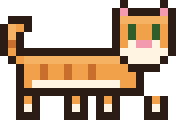
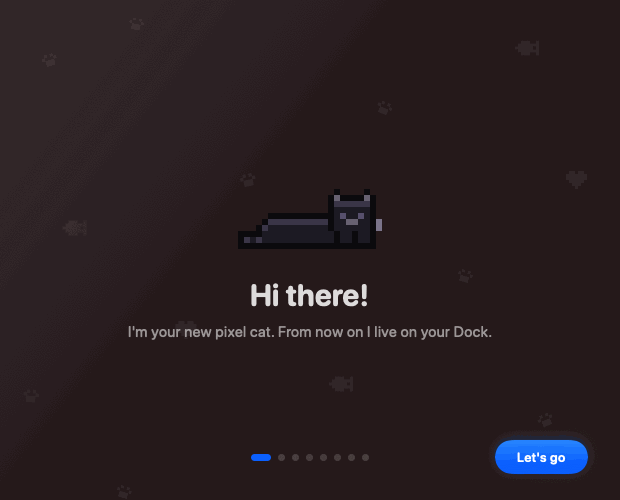
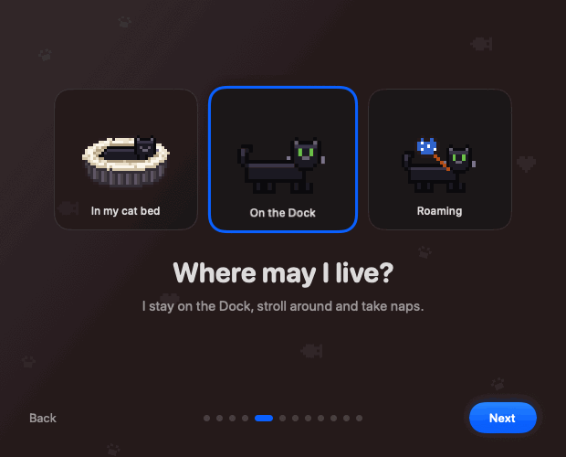
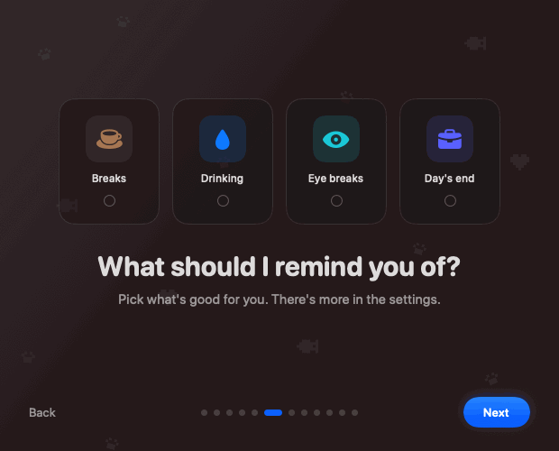
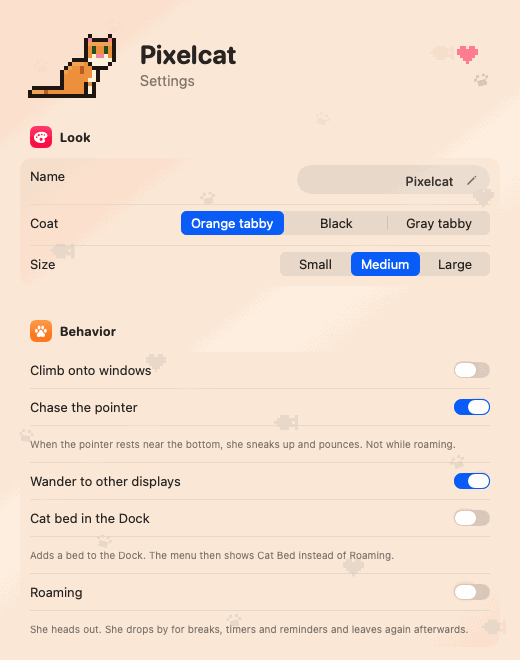

# Pixelcat 🐈

<p align="center">
  &nbsp;&nbsp;
  &nbsp;&nbsp;
  &nbsp;&nbsp;
  &nbsp;&nbsp;
  
</p>

A tiny pixel art cat for your Mac. She lives on top of your Dock, strolls back and forth, curls up and naps,
and gently flicks the tip of her tail while she sleeps. Pick an orange tabby, a black cat or a gray tabby and
give her a name.

Pixelcat is also a soft productivity buddy: she reminds you to take breaks, drink water, rest your eyes, think
of your tasks and call it a day. She never gets in the way and hides during video calls.

## Features

### Living on your Dock

- **Petting:** Move the pointer over her without clicking. She wakes up, squints happily, leans into your hand
  and purrs. Then she settles down again.
- **Startling:** A click makes her jump and run off a little.
- **Feeding:** A bowl appears, she walks over, eats it all up and grooms herself afterwards.
- **Yarn ball:** A ball of yarn drops in. She chases it and swats it with her paw. You can grab, lift and throw it.
- **Climbing:** In climbing mode she wants to go up. She climbs the side of a window or jumps on top, balances
  along the edge, leaps from window to window and naps up there. Move a window and she rides along. Close it and
  she drops onto the Dock. She stays on the Dock in full screen and Split View.
- **Chasing the pointer:** When the pointer rests just above the Dock, she sneaks up, wiggles her behind and pounces.
- **Quirks:** She grooms her paw and head, yawns, stretches after waking up and sometimes rolls onto her back.
- **Time of day:** Busy and curious during the day (9 am to 7 pm), cozy in the morning and evening, sound asleep at
  night (11 pm to 6 am).
- **Multiple displays:** If there is a display next to the main one, she wanders over now and then.
- **Full screen:** When an app is in full screen (no Dock), she hops down to the bottom edge of the screen.
- **Cat bed in the Dock:** Optional. A plush oval bed appears in your Dock. With **Cat Bed** turned on she shrinks to
  bed size, climbs in, turns once and sleeps there. In the Dock icon she breathes and lifts her tail now and then.
  She climbs out for breaks, timers and reminders and goes back afterwards. You can move the bed anywhere in the Dock.
- **Roaming:** Without the bed she heads out and is gone. She only drops by for breaks, timers and reminders.
- **A bird while you're away:** After a while without input (10 minutes by default) a little bird flutters across
  the screen. She comes out of her bed or in from roaming, looks around shyly and chases it, swatting when it swoops
  low and leaping when it flies higher. As soon as you're back, the bird flies off and she hurries back to her bed
  or out again.

### Gentle reminders

- **Pomodoro:** 25 minutes of focus while she sleeps deeply and can't be disturbed. Then she wakes up, stretches
  and strolls around for 5 minutes. The time left is shown next to the menu bar icon.
- **Timer:** Set your own time (5 to 60 minutes or a custom value like `25` or `1:30`). She sleeps until it runs
  out, then walks to the middle of the screen, meows and asks for attention until you pet or click her.
- **Break reminder:** Every 45 to 55 minutes, or **by activity**: Pixelcat then only counts the time you type,
  click or move the mouse. Five minutes away count as a break and the count starts over. Pixelcat only asks macOS
  how long ago the last input was. No keys are read and no permission is needed.
- **Drink reminder:** About every 45 minutes she puts down a blue water bowl, laps for a while and thinks “Drink”.
- **Eye break:** About every 20 minutes a small window pops up with sky, sun, hills and a drifting cloud. She sits
  on the sill and gazes out for half a minute. Look into the distance with her.
- **End of the workday:** At your chosen time (weekdays only if you like) she puts on a top hat and bow tie, walks
  to the middle and thinks “Off work”.
- **Tasks:** Add short notes like “Call mom” in the tasks window, each with **a time of day**. She thinks of each
  task once a day at its time. If your Mac was asleep or off, she catches up within three hours. Optionally also
  during video calls: she stays hidden and only the thought bubble appears at the Dock. Never while you share your
  screen.
- **Motivation:** Add your own sayings in the settings (or let her use hers). She cheers you on in the morning
  between 9 and 10 and shortly before the end of your workday, on long days once in between. Never more often than
  every four hours and never during video calls.
- **One at a time:** Reminders wait for each other and for breaks, Pomodoro and timers. Every reminder can be
  previewed in the settings with **Show now**. A click pops the thought bubble.

### Outfits

- **Evening:** Top hat and bow tie after work, until bedtime.
- **Night:** A starry nightcap from bedtime until 5 am.
- **Morning:** A sleep mask pushed up on her forehead until your chosen time.
- **Holidays:** A pumpkin at Halloween, a Santa hat on December 24 and 25, a party hat on New Year's Eve and New
  Year's Day.

### Considerate

- **Video calls and screen sharing:** While the camera or microphone is on or the screen is shared, she hides
  and comes back afterwards. Reminders wait until then.
- **Focus:** During a macOS Focus like Do Not Disturb she stays quiet and sleeps more.
- **Sounds:** Soft, real cat sounds for Pomodoro, timers, breaks, drinking, eye breaks and the end of the day.
  Purring while you pet her. Never in video calls or Focus. Everything can be turned off.
- **Languages:** English and German.

## Install

With [Homebrew](https://brew.sh):

```bash
brew install --cask theesbudde/pixelcat/pixelcat
```

Update with `brew upgrade --cask pixelcat`. Without Homebrew: download the ZIP from the latest
[release](https://github.com/TheesBudde/pixelcat/releases/latest), unzip it, move `Pixelcat.app` to your
Applications folder and open it with right click › Open the first time.

On first launch a short setup welcomes you, one small step per page. You pick English or German, give your cat a
name, choose her coat and where she lives (in her cat bed, on the Dock or roaming) and pick your reminders. A little
tour then shows how she reminds you, remembers your tasks, heads out and likes to be petted. When you click Done she
wakes up, jumps out of the window and drops onto your Dock, shrinking to her size on the way down. Then she heads to
her bed, walks off or stays, just as you chose. You can open the setup again in the settings.

Your settings survive updates. Pixelcat also keeps a copy in
`~/Library/Application Support/Pixelcat/Settings.plist` and restores it if the settings are ever lost.

<p align="center">
  
  
  
</p>

## Using Pixelcat

Pixelcat has **no Dock icon** (unless you turn on the cat bed). It lives in the **menu bar** as a little cat head.

| Menu item | What it does |
|---|---|
| Hide / Show cat (⌘K) | Turn her on and off |
| Pomodoro | Focus and breaks in turns (checkmark = running) |
| Timer ▸ 5 … 60 min / Custom time … | Set a timer (click again to stop) |
| Break reminder | Regular breaks (on/off) |
| Drink reminder · Eye break | Small reminders (on/off) |
| Task reminder ▸ | On · Also during video calls · Your tasks with their times · Add and edit tasks … |
| Motivation | Sayings in the morning and towards the end of the day (on/off) |
| Roaming | She heads out and only comes in for breaks and reminders |
| Cat Bed | Replaces Roaming when the cat bed is in the Dock: she sleeps in the bed |
| Feed · Play with yarn · Startle · Put to sleep | Actions |
| Settings … (⌘,) | Everything else |
| Quit Pixelcat (⌘Q) | Quit |

The **settings window** is one scrolling page with her portrait on top. All windows follow her coat: dark for the
black cat, light with a hint of orange for the orange tabby, light gray for the gray tabby.



- **Look:** Name, coat, size
- **Behavior:** Climbing, chasing the pointer, other displays, cat bed in the Dock, Roaming or Cat Bed
- **Pomodoro and breaks:** Focus and break length, break reminder at set intervals or by activity, break length
- **Drinking and eyes:** On/off, rough interval, Show now
- **End of the workday:** On/off, time, Monday to Friday only
- **Outfits:** Nightcap at bedtime, morning outfit until a set time
- **Tasks:** Opens the tasks window (tasks with their times)
- **Motivation:** On/off, your sayings, Show now
- **While you're away:** Chase a bird after a set time without input, Show now
- **Sounds and being considerate:** Meow, meow for tasks, purring, hide during calls, respect Focus
- **Language:** Same as macOS, Deutsch, English

To keep her around, add Pixelcat under *System Settings › General › Login Items*.
<br clear="right">

## How it works

Pixelcat is a plain Swift app built with AppKit and SwiftUI, without an Xcode project. A transparent, borderless
panel floats above everything and carries the cat along the top edge of the Dock. A state machine decides what
she does next, and every pose is a small text grid drawn pixel by pixel.

See **[docs/ARCHITECTURE.md](docs/ARCHITECTURE.md)** for the technical sketch with diagrams.

## Build from source

```bash
./build.sh
open build/Pixelcat.app
```

`build.sh` calls `swiftc` directly and packages the `.app` for your Mac (`UNIVERSAL=1` builds for Apple Silicon
and Intel). Requires macOS 13 or later and the Xcode command line tools.

### Demo and previews

```bash
open build/Pixelcat.app --args --demo              # always afternoon, climbs a lot
open build/Pixelcat.app --args --outfit santa      # pumpkin, santa or party
open build/Pixelcat.app --args --onboarding        # show the setup again
```

To draw your own poses, edit the text grids in `Sources/Sprites.swift` and run `./build.sh` again.

### Tests

```bash
./test.sh       # play through scenarios and check them
./preview.sh    # render sprites, bubbles, props and all windows to build/preview/
```

`test.sh` plays through the cat bed (breaks, timers, reminders, calls, full screen, clicks and a bed moved in the
Dock, also in the middle of climbing in or out), all reminders (drinking, eye breaks, end of the workday, tasks,
activity, overlaps with breaks and Pomodoro), the bird chase with and without the bed, and the calm cat on the
welcome page.

On the real screen, with the installed app (it quits afterwards and writes `build/selftest.log`):

```bash
/Applications/Pixelcat.app/Contents/MacOS/Pixelcat --selftest         # all reminders
/Applications/Pixelcat.app/Contents/MacOS/Pixelcat --selftest calls   # simulated video call
```

To calibrate against a real Dock, start Pixelcat with `PIXELCAT_CALIBRATE=1`. The Dock icon first shows the
sleeping cat, after 6 seconds the last frame of the climbing animation is drawn on top.

### Releasing

```bash
./release.sh v6.2
```

This builds for Apple Silicon and Intel and creates `build/Pixelcat-v6.2.zip`. Upload it on GitHub under
*Releases › Draft a new release*, then update Homebrew:

```bash
./update-cask.sh v6.2
```

This downloads the published ZIP, writes version and checksum into the tap
([homebrew-pixelcat](https://github.com/TheesBudde/homebrew-pixelcat), expected next door in `../homebrew-pixelcat`),
commits and pushes.

## Credits

Cat sounds: “Cat Purr & Meow” by Kerzoven ([opengameart.org](https://opengameart.org/content/cat-purr-meow), CC0),
trimmed and leveled. Everything else, including all pixel art, is drawn in code.
