# Pixelcat architecture

A technical sketch of how Pixelcat works. About 8,700 lines of Swift in `Sources/`, built with `swiftc` directly
(no Xcode project) into a menu bar app (`LSUIElement`) for macOS 13 and later.

## The big picture

```
┌─ Menu bar ──────────────────────────────── [cat] ◄── NSStatusItem (AppDelegate)
│                                                       menu: Pomodoro, timer, reminders, settings
│
│     ┌─────────────┐        ┌────────┐
│     │ eye break   │        │ /\_/\  │ ◄── borderless, transparent NSPanel (CatController)
│     │ window      │        │ (o.o)  │     floats above all windows on every Space
│     │ (PropWindow)│        └────────┘     and never takes focus away from your app
│  ═══╧═════════════╧════════════════════ ◄── top of the Dock = NSScreen.visibleFrame.minY
│  [ Dock   ▢ ▢ ▢ ▢ (bed) ▢ ▢ ]          ◄── optional cat bed: Dock tile view (BasketTileView)
└──────────────────────────────────────────
```

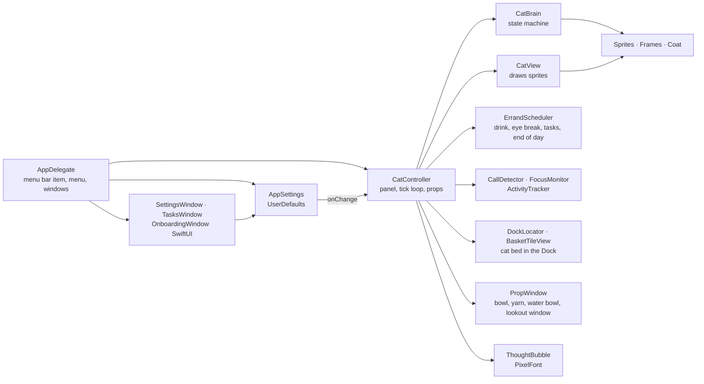

## Source files

| File | What lives there |
|---|---|
| `main.swift` | Starts `NSApplication` with the `AppDelegate` |
| `AppDelegate.swift` | Menu bar item and menu, opens the windows, wires settings to the cat, launch flags |
| `Controller.swift` | `CatController`: the cat panel, the tick loop, Pomodoro and timer, props, errands, outfits, cat bed |
| `Cat.swift` | `CatBrain` (state machine), `Temperament` (time of day), `CatView` (drawing and hit testing), yarn physics |
| `Sprites.swift` | Every pose as a text grid, coats and palettes, hats, outfits, menu bar icon |
| `Reminders.swift` | `ErrandScheduler`, `TaskItem`, `OutfitTimes`, `ActivityTracker`. Pure logic, no windows |
| `Basket.swift` | `BasketArt` (the plush bed), `BasketTileView` (Dock icon), `DockLocator` (where the bed sits) |
| `Lookout.swift` | The eye break window: frame, sky, sun, hills and a drifting cloud |
| `Bird.swift` | The bird she chases while you're away: steering flight, swoops, dodging, flying off |
| `Bubble.swift`, `PixelFont.swift` | Thought bubbles with a hand drawn pixel font (letters, umlauts, digits, punctuation) |
| `Sensors.swift` | `CallDetector` (camera, microphone, screen sharing), `FocusMonitor` |
| `Sound.swift` | `Meow` and `Purr` |
| `Settings.swift` | `AppSettings` and the settings window |
| `TasksWindow.swift` | The tasks window |
| `Onboarding.swift` | First launch setup: language, name, coat, home, reminders, a short tour, the drop onto the Dock |
| `PixelArtViews.swift` | Sprites as SwiftUI views and the faint pixel backdrop of the windows |
| `Localization.swift` | `L10n.s("Deutsch", "English")`: both languages side by side in code |
| `SelfTest.swift` | On screen self test (`--selftest`, `--selftest calls`) |
| `Export.swift` | Sprite sheet and app icon export |

## Drawing

Every pose is a text grid with one character per pixel:

```
"...............K....K..."     K outline   O fur      h highlight   s stripes
"..............KPKKKKPK.."     W chest     E eyes     P nose, ears  w whiskers
"..............KhhhhhhK.."     . transparent
```

A `Coat` maps the letters to colors, so one set of grids gives the orange tabby, the black cat and the gray tabby.

<p>
  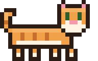&nbsp;
  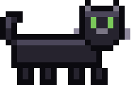&nbsp;
  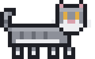&nbsp;&nbsp;&nbsp;
  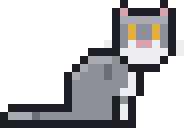&nbsp;
  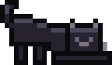&nbsp;
  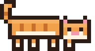&nbsp;
  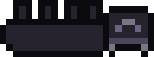&nbsp;
  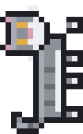
</p>

Pixels are filled as plain squares without antialiasing. Facing left is mirrored, closed and happy eyes are generated.
Hats and the bow tie are separate sprites pinned to anchors (`earAnchor`, `collarAnchor`) that each pose knows.

The windows reuse the same sprites: `PixelSprite` and `PixelCat` render them as SwiftUI images, so the settings
header and the setup always show the cat in her current coat.

## Behavior

`CatBrain` is a state machine. Every tick it advances the current phase and picks the next one.

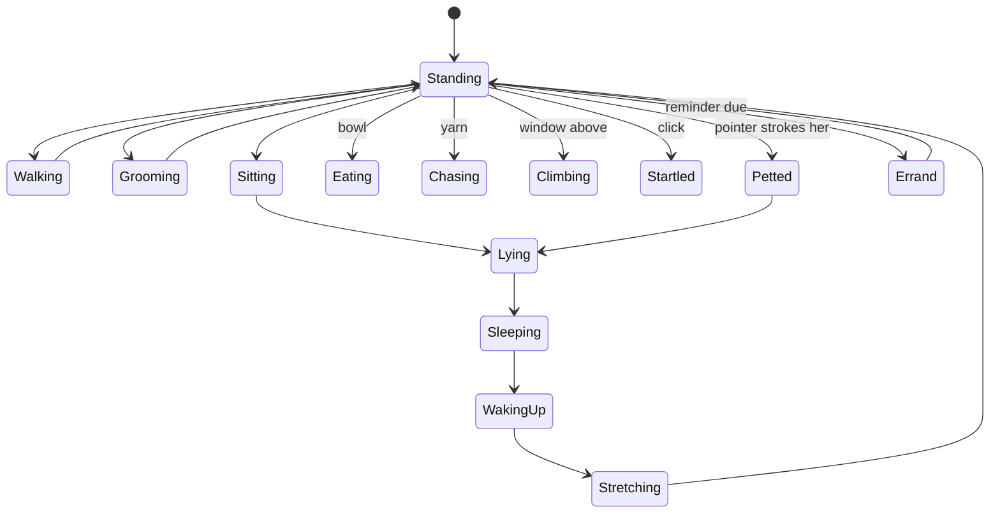

How far she walks, how long she sleeps and how far she runs depends on the hour (`Temperament`). She blinks
now and then and breathes while asleep.

## The tick loop

`CatController` runs a timer: 30 frames per second while something moves, 8 when she rests, 2 when she is away.
Each tick it

1. reads the pointer position (petting is the pointer moving over visible cat pixels without a button pressed),
2. reads the window list (`CGWindowListCopyWindowInfo`, no titles, no permission) to find perches for climbing,
3. checks calls, Focus and activity,
4. collects due reminders and starts one when the cat is free,
5. advances `CatBrain`, moves the panel and redraws.

Clicks only hit visible cat pixels (`hitTest`). The transparent area around her lets clicks through.

## Reminders

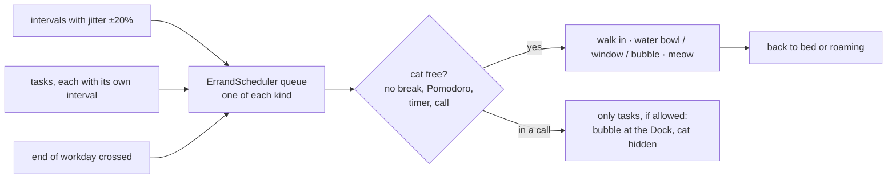

The bird is an errand too. When no input has arrived for the set time, the controller starts it: the cat comes in
(or climbs out of her bed), peeks left and right, then chases. `CatBrain` runs under the bird, swats when it flies low
and reuses the pounce jump when it is higher. On the next input the bird flies off, the errand ends and she hurries
back.

Only one reminder runs at a time. The scheduler is plain logic with an injectable clock and random source, which
is what `test.sh` exercises.

Breaks by activity use `ActivityTracker`: it adds up the seconds with input in the last minute and resets after
five idle minutes. Pixelcat only asks macOS how long ago the last input was.

Outfits follow `OutfitTimes`: top hat and bow tie from the end of the workday until bedtime, nightcap until 5 am,
sleep mask until the morning ends. Holidays win over everything.

## Cat bed in the Dock

With the bed turned on, Pixelcat switches to a regular app (that is what gives it a Dock icon) and sets `NSApp.dockTile.contentView` to a
`BasketTileView`. The bed is drawn in two layers, back and front, with the sleeping cat in between.

To climb in and out at the right spot, `DockLocator` asks the Dock for the tile's frame through the Accessibility API
when permission is granted. Without it, it estimates the position from the Dock preferences: tile size, pinned and
running apps, spacers, folders, recent apps and how the Dock shrinks when it is full. The position is read right before she climbs in or
out, so moving the bed in the Dock just works. With the Dock on the side, hidden, or behind a full screen app, she
walks off the edge instead.

## Being considerate

`CallDetector` checks whether a camera or microphone is in use through CoreMediaIO and CoreAudio, and detects screen
sharing from the macOS sharing processes and Zoom. No permission is needed. `FocusMonitor` reads the Focus status
through `INFocusStatusCenter` after the user allows it once.

## Settings and windows

`AppSettings` is one `ObservableObject` for everything, stored in `UserDefaults`. Every change calls `onChange`, and
the controller applies it right away. The settings, tasks and setup windows are SwiftUI views in `NSHostingView`s.
The setup appears on first launch when no settings are stored yet, and can be opened again from the settings.
Every change is also written to `~/Library/Application Support/Pixelcat/Settings.plist`. If the preferences are
missing on launch, Pixelcat restores them from there.

The windows follow the cat's coat (`Coat.appearance`, `Coat.backdrop`): dark for the black cat, light with an orange
tint for the orange tabby, light gray for the gray tabby.

## The setup

`OnboardingView` is a row of small pages: welcome, language, name, coat, home, an optional question about Accessibility
access for the cat bed, reminders, a short tour and the last page. The cat stays off the Dock until the setup is done,
and the chosen home (`Home`: cat bed, Dock or roaming) is applied only at the very end, so the Dock icon never changes
in the middle of it.

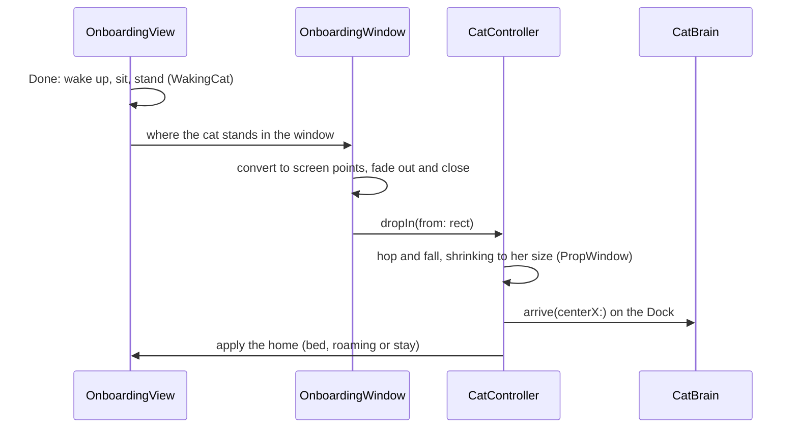

On the welcome page `PlayfulCatModel` lets the cat sleep until the pointer enters the window. Then she sits up, stands
and strolls slowly, and only later sits, grooms or stretches. The petting page tracks the pointer over the cat and plays
the purr. The last page and the drop show her current outfit (`CatController.outfitNow()`), so she wears her top hat in
the evening right away.

## Sounds

Real cat recordings from “Cat Purr & Meow” by Kerzoven (opengameart.org, CC0), trimmed and leveled, in
`Resources/Sounds`. Meows never play during calls or Focus. The purr loops and fades in and out.

## Testing

- `test.sh` compiles the sources with `Tests/main.swift` and plays through scenarios without a screen: the cat bed,
  every reminder, overlaps, the scheduler queue, the bird chase and the welcome page cat.
- `preview.sh` renders sprites, bubbles, props and all windows to `build/preview/` for a visual check.
- `--selftest` runs every reminder on the real screen and checks the result. `--selftest calls` simulates a call.
